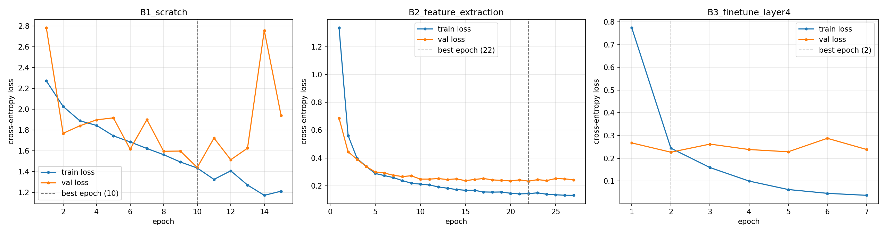

# Tugas 05: Transfer Learning untuk Klasifikasi Citra dengan Data Terbatas

**Nama:** Fiko
**NIM:** 2802520274
**Mata kuliah:** Deep Learning, Sesi 05 (Advanced CNNs and Transfer Learning)

Eksperimen ini membandingkan beberapa strategi pelatihan ResNet-18 pada subset 10 kelas Oxford-IIIT Pet, yaitu 5 ras kucing (Abyssinian, Bengal, Birman, Ragdoll, Russian Blue) dan 5 ras anjing (American Pit Bull Terrier, Staffordshire Bull Terrier, Beagle, Pug, Samoyed). Data dibagi secara stratified 70/15/15 (1.390 train / 298 val / 299 test) dengan seed 42.

## Protokol

| Item | Nilai |
|---|---|
| Arsitektur utama | ResNet-18 (`ResNet18_Weights.IMAGENET1K_V1`) |
| Input | 224 × 224, normalisasi ImageNet |
| Batch size / optimizer / loss | 32 / AdamW (weight decay 0,01) / CrossEntropyLoss |
| Early stopping | Monitor validation loss, patience 5, maks. 30 epoch |
| Augmentasi (hanya train) | RandomResizedCrop (0,8–1,0), HorizontalFlip, Rotation 15°, ColorJitter (brightness, contrast) |
| Seed | 42 (Python, NumPy, PyTorch, cuDNN deterministic) |
| Hardware | Google Colab, Tesla T4 |

## Hasil

| Kode | Strategi | Trainable params | Learning rate | Epoch terbaik / total | Waktu (s) | Val acc | Test acc | Test Macro F1 |
|---|---|---:|---|:---:|---:|---:|---:|---:|
| B1 | ResNet-18 from scratch | 11.181.642 | semua: 1e-3 | 10 / 15 | 227,5 | 49,33% | 46,15% | 45,91% |
| B2 | Feature extraction (backbone beku, hanya `fc`) | 5.130 | fc: 1e-3 | 22 / 27 | 364,2 | 90,27% | 88,96% | 88,85% |
| B3 | Fine-tuning `layer4` + `fc`, dengan augmentasi | 8.398.858 | layer4: 1e-4; fc: 1e-3 | 2 / 7 | 95,0 | 89,60% | 90,64% | 90,29% |
| B4 | Konfigurasi B3 tanpa augmentasi | 8.398.858 | layer4: 1e-4; fc: 1e-3 | 2 / 7 | 69,3 | 91,95% | 90,64% | 90,45% |
| B5 | EfficientNet-B0, fine-tuning `features[7:9]` + classifier, tanpa augmentasi | 1.142.202 | features[7:9]: 1e-4; classifier: 1e-3 | 7 / 12 | 120,8 | 92,95% | 94,98% | 94,95% |

Untuk B4, skenario "dengan augmentasi" adalah run B3. Konfigurasi B5 dipilih dari run ResNet-18 dengan val accuracy tertinggi (B4). Analisis lengkap ada di laporan.



## Isi repositori

```
├── README.md
├── requirements.txt
├── Tugas05_Transfer_Learning.ipynb     notebook yang sudah dieksekusi (dengan output)
├── report/
│   └── Laporan_Tugas05.pdf             Bagian A + laporan Bagian C
└── outputs/
    ├── results_summary.csv / .json     metrik akhir setiap run
    ├── all_epoch_logs.csv              log per epoch semua run
    ├── logs/<run>_epochs.csv           log per epoch per run
    ├── predictions/<run>_test_predictions.csv
    ├── split_manifest.csv              daftar file per split (bukti tidak ada data leakage)
    ├── config.json, env.json           konfigurasi eksperimen dan environment
    ├── C1_consolidated_table.csv/.md
    ├── C3_misclassified.csv
    ├── C5_layer4_weight_drift.csv
    └── figures/                        kurva loss, confusion matrix, misklasifikasi, Grad-CAM
```

Checkpoint model (`.pt`) tidak diunggah karena ukurannya besar. Semua angka di laporan bersumber dari file CSV/JSON di folder `outputs/`.

## Cara menjalankan

1. Buka `Tugas05_Transfer_Learning.ipynb` di Google Colab.
2. Runtime → Change runtime type → **T4 GPU**.
3. Runtime → **Run all**. Dataset diunduh otomatis melalui `torchvision.datasets.OxfordIIITPet`.
4. Output tersimpan di Google Drive (`MyDrive/Tugas05_outputs`). Jika sesi terputus, jalankan *Run all* lagi; run yang checkpoint-nya sudah ada akan dimuat ulang tanpa dilatih ulang.

Dependensi ada di `requirements.txt` (versi dari environment Colab saat eksperimen dijalankan).

## Referensi

- K. He, X. Zhang, S. Ren, J. Sun. *Deep Residual Learning for Image Recognition.* CVPR 2016.
- M. Tan, Q. V. Le. *EfficientNet: Rethinking Model Scaling for Convolutional Neural Networks.* ICML 2019.
- O. M. Parkhi, A. Vedaldi, A. Zisserman, C. V. Jawahar. *Cats and Dogs.* CVPR 2012.
- R. R. Selvaraju et al. *Grad-CAM: Visual Explanations from Deep Networks via Gradient-based Localization.* ICCV 2017.
